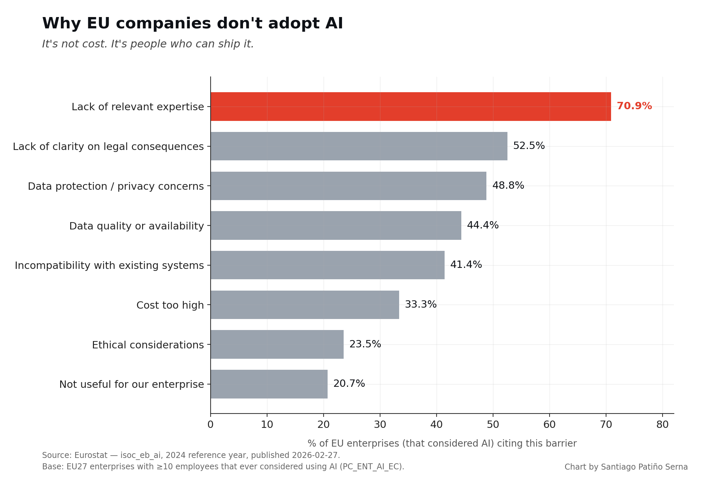
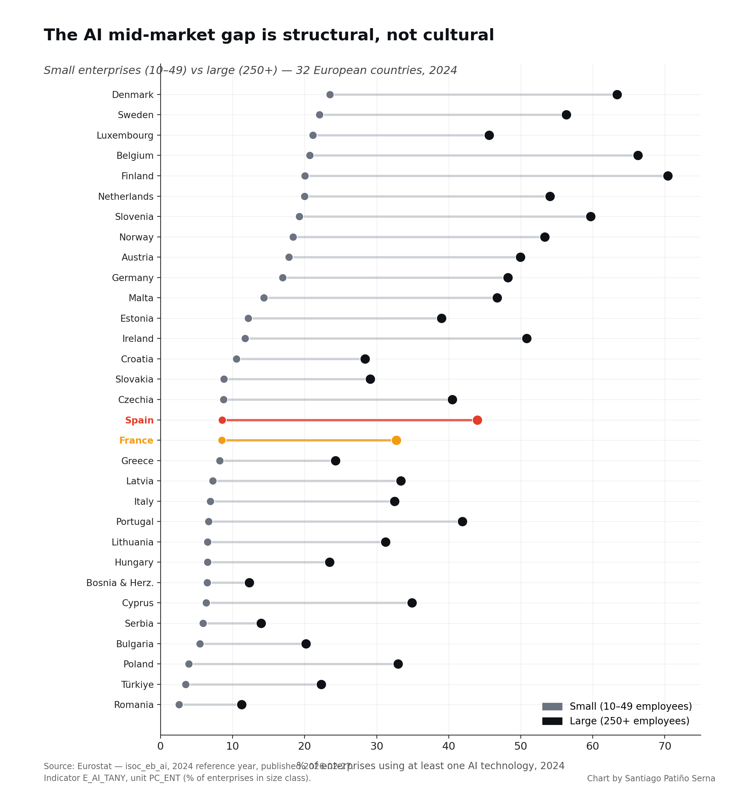
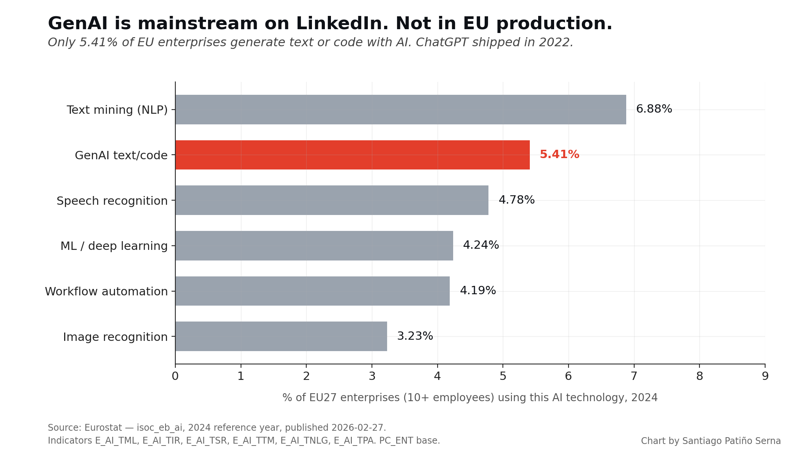

# EU Enterprise AI Adoption 2024 — the data nobody likes to quote

Primary-source analysis of Eurostat's **`isoc_eb_ai`** dataset — "Artificial intelligence by size class of enterprise" — reference year 2024, published 2026-02-27.

> **TL;DR.** Three years after ChatGPT, 13.48% of EU enterprises (10+ employees) use any AI technology. For GenAI text generation: 5.41%. And when companies that *considered* adopting AI explained why they didn't, **cost ranked 6th**. **Lack of expertise ranked 1st (70.89%)** — a 37-point gap over cost.

This repo contains the raw Eurostat JSON, a reproducible Python pipeline, and three charts you can re-use.

---

## The headline finding



When Eurostat asked the enterprises that *considered* adopting AI why they didn't:

| Rank | Reason | % of enterprises that considered AI |
|---|---|---|
| 1 | Lack of relevant expertise | **70.89%** |
| 2 | Lack of clarity on legal consequences | 52.52% |
| 3 | Data protection / privacy concerns | 48.83% |
| 4 | Data quality or availability | 44.37% |
| 5 | Incompatibility with existing systems | 41.39% |
| 6 | Cost too high | 33.34% |
| 7 | Ethical considerations | 23.53% |
| 8 | Not useful for our enterprise | 20.68% |

Cost is below data quality. Below "we don't know the legal consequences." The dominant constraint on EU AI adoption is not capex — it's human capital.

---

## The size gap is structural



| Company size (EU27) | % using ≥1 AI tech, 2024 |
|---|---|
| Small (10–49 employees) | 11.21% |
| Medium (50–249 employees) | 20.97% |
| **Large (250+ employees)** | **41.17%** |

That's a **3.7x ratio** between large and small enterprises across the EU. In Spain it widens to **5.14x**. In Poland: **8.38x**.

---

## GenAI vs the LinkedIn narrative



EU27 enterprises (10+ employees) using each AI technology in 2024:

| Technology | % of enterprises |
|---|---|
| Text mining (NLP) | 6.88% |
| **GenAI text/code generation** | **5.41%** |
| Speech recognition | 4.78% |
| ML / deep learning | 4.24% |
| Workflow automation | 4.19% |
| Image recognition | 3.23% |
| Autonomous robotics | 1.01% |

---

## Country ranking (top 15 + bottom)

| Rank | Country | % using AI (10+ employees) |
|---|---|---|
| 1 | Denmark | 27.58% |
| 2 | Sweden | 25.09% |
| 3 | Belgium | 24.71% |
| 4 | Finland | 24.37% |
| 5 | Luxembourg | 23.73% |
| 6 | Netherlands | 23.06% |
| 7 | Slovenia | 20.89% |
| 8 | Norway | 20.77% |
| 9 | Austria | 20.27% |
| 10 | Germany | 19.75% |
| — | **EU27 average** | **13.48%** |
| 15 | Spain | 11.31% |
| 18 | France | 9.91% |
| 23 | Italy | 8.20% |
| 32 | Romania | 3.07% |

France ranks 18th of 32 European countries — below Slovenia, Norway, Estonia. Italy at 23rd.

---

## Reproduce in 30 seconds

```bash
git clone https://github.com/santiagopatinoserna/eu-ai-adoption-2024.git
cd eu-ai-adoption-2024
pip install pandas matplotlib
python scripts/fetch.py      # downloads the raw Eurostat JSON to data/
python scripts/analyze.py    # writes 3 CSVs to data/
python scripts/chart.py      # writes 3 PNGs to charts/
```

No API key needed. Eurostat's REST API is free and open.

---

## Repository layout

```
.
├── data/
│   ├── eurostat_isoc_eb_ai_raw.json      ← raw API response, 16,721 cells
│   ├── ai_tany_all.csv                   ← country × size × AI use
│   ├── ai_adoption_country_size_gap.csv  ← gap analysis
│   └── ai_small_enterprises_country.csv  ← small-enterprise ranking
├── scripts/
│   ├── fetch.py     ← pulls Eurostat
│   ├── analyze.py   ← long-form pandas analysis
│   └── chart.py     ← matplotlib charts
├── charts/
│   ├── chart_barriers.png
│   ├── chart_size_gap.png
│   └── chart_genai_reality.png
├── ANALYSIS_EN.md   ← long-form write-up
├── README.md
└── LICENSE
```

---

## Methodology & caveats

- **Source.** Eurostat `isoc_eb_ai` — public dataset, reference year 2024, published 2026-02-27.
- **Geographic scope.** EU27 + EFTA + selected candidate countries (32 with country-level data).
- **Sector scope.** NACE Rev. 2 sections C10–S95 excluding K (financial). Industry + services aggregate.
- **Sample.** Enterprises with ≥10 employees. Micro-enterprises (<10) excluded by the headline indicator.
- **Self-reported.** Companies may over- or under-state "we use AI." This is survey data, not telemetry.
- **Shadow AI not measured.** Employees using personal ChatGPT accounts at work are invisible to this dataset.
- **No causation.** The size-gap correlation is structural, not causal.

---

## License

- **Code (scripts/):** MIT
- **Charts (charts/):** CC BY 4.0 — attribute "Chart by Santiago Patiño Serna, data: Eurostat"
- **Eurostat data:** © European Union, redistributed under Eurostat's [free re-use policy](https://ec.europa.eu/eurostat/about-us/policies/copyright)

---

## Author

Santiago Patiño Serna — [LinkedIn](https://www.linkedin.com/in/santiagopatinoserna/)

Issues and PRs welcome. If you re-run this for a different country cut or a different year, send a PR.
